# Single-Cell Sequencing Data Analysis Report

> English translation of the original coursework report. The analysis code is [notebooks/code.ipynb](../notebooks/code.ipynb).

## 1. Abstract

Single-cell sequencing is a key tool for resolving cell populations and reprogramming mechanisms. This analysis focuses on a megakaryocyte reprogramming dataset and covers preprocessing, batch correction, clustering and annotation, and enrichment analysis. Key findings: 1) BBKNN effectively removes batch effects; 2) Leiden clustering yields 13 clusters, annotated as 5 cell types, and successfully identifies the core clusters such as iMK and iMK_2; 3) the "EB → iPEM → iMK" differentiation path is confirmed; 4) iMK is oriented toward platelet production and iMK_2 toward immune regulation (KEGG pathway enrichment), consistent with the "dual function" reported in the literature.

## 2. Introduction

The reference paper dissects the process of megakaryocyte reprogramming and defines the differentiation stages and functional features of the cells. Based on its data, this analysis verifies the core conclusions with a standard workflow and evaluates how analysis tools and parameters affect the results, providing data support for research on the reprogramming mechanism.

## 3. Materials and Methods

### 3.1 Data source

The sequencing platform is 10x Genomics. The samples are four groups from megakaryocyte reprogramming and differentiation: D0, D3, D5 and D7. The raw data are in the standard 10x .mtx format and were combined into an .h5ad file with batch, sample and differentiation-time annotations.

### 3.2 Analysis environment and tools

A separate conda environment named "scRNA_new" was used. The core tool is Python; the key dependency and version is scanpy==1.10.3 (used for the whole workflow).

## 4. Preprocessing and Quality Control

### 4.1 Data loading and initial QC

Reading the multi-batch legacy 10x data with Scanpy's default `read_10x_mtx` function caused compatibility problems, so a custom reader `read_old_10x_mtx` was written with AI assistance to import the data.

Initial QC was done separately for each batch: genes expressed in at least 5 cells (`min.cells=5`) and cells with at least 300 detected genes (`min.features=300`) were kept. After per-batch QC, the batches were merged into a single `AnnData` object (.h5ad) with `scanpy.concat` for downstream analysis.

### 4.2 Quality control

Meaning of the mitochondrial fraction: the percentage of mitochondrial genes is a core QC metric, tied to both the technology and the cell state. In intact cells the ratio of nuclear to mitochondrial transcripts is stable. When cells are damaged or apoptotic, nuclear mRNA is easily lost while the abundant and stable mitochondrial transcripts remain, so their share rises sharply (20–25% is usually considered abnormal). A high fraction indicates apoptosis, stress or death; such expression profiles do not reflect a normal physiological state, and keeping them would interfere with the analysis (for example by forming "false clusters" that mislead annotation, or by adding apoptotic noise that masks specific signals). Following the methods of the original paper, cells with pct_counts_mt > 15% were removed to keep the data reliable.

Also following the paper, cells with a library size (total_counts) < 2500 were removed. A very low library size usually indicates poor capture efficiency or mRNA loss; the expression information of such cells is incomplete, and removing them further improves data quality.

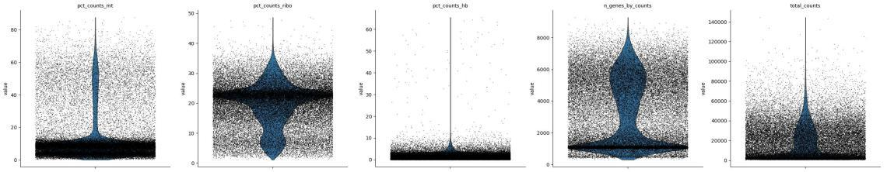

**Figure 1. Violin plots of the core QC metrics before QC.** Distributions of pct_counts_mt (mitochondrial gene fraction), pct_counts_ribo (ribosomal gene fraction), pct_counts_hb (hemoglobin gene fraction), n_genes_by_counts (detected genes) and total_counts (total counts). The width of each violin is the density of cells at that value; the lines are quartiles.

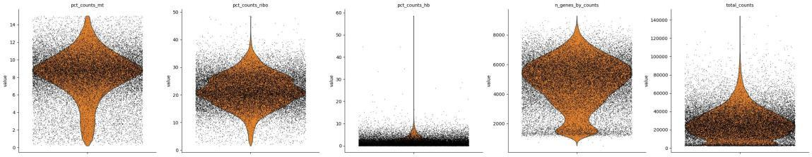

**Figure 2. Violin plots of the core QC metrics after QC.** The same five metrics as in Figure 1. Cells with high mitochondrial fractions and few detected genes have been removed, and the distributions are more concentrated.

After filtering low-quality cells and small libraries, data quality improved clearly. The distribution of detected genes (n_genes_by_counts) shifted toward higher values, indicating more complete expression information; the ribosomal (pct_counts_ribo) and hemoglobin (pct_counts_hb) fractions shifted toward 0, indicating less technical noise; and the sequencing depth of the remaining cells was more uniform, providing a reliable basis for normalization and downstream analysis.

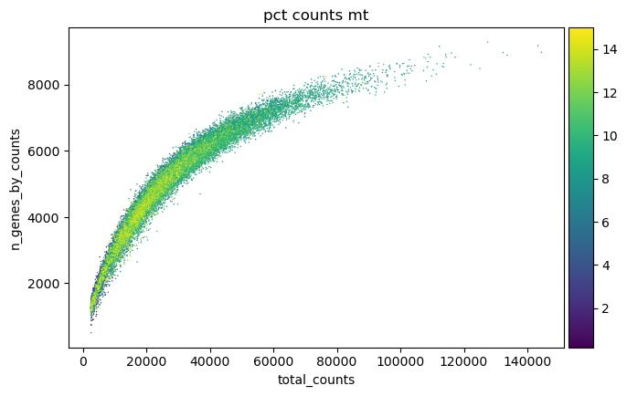

**Figure 3. Scatter plot of total counts vs detected genes.** x axis: total counts (total_counts); y axis: detected genes (n_genes_by_counts); color: mitochondrial fraction (pct_counts_mt). Total counts and detected genes are positively correlated, and cells with high mitochondrial fractions are mostly found at low counts and low gene numbers, further supporting the QC filtering.

### 4.3 Doublet removal

Algorithm choice: Scrublet was chosen because it is designed for single-cell RNA-seq and is unsupervised. It needs no known cell-type proportions or reference data; it computes a doublet score by comparing simulated doublets with the observed data. It suits the cell-population setting of this study, is easy to use and is reasonably accurate. After doublet removal, 27,745 cells remained.

This step is listed here only to show where it sits in the workflow; it is analyzed later (Section 8).

### 4.4 Normalization

Single-cell sequencing has technical biases from differences in capture efficiency and uneven sequencing depth (different cells capture different total amounts of mRNA and receive different numbers of reads), so comparing raw counts directly leads to wrong conclusions and the data must be normalized. This analysis uses Scanpy's `normalize_total(target_sum=1e4)`, a library-size normalization: each cell's raw counts are divided by the cell's total counts (its library size) and multiplied by the target value 1e4 (counts per 10,000), making gene counts comparable across cells. This removes the bias where a cell that captured more mRNA has higher counts for every gene.

The following log transformation `log1p` (that is, `log(1+x)`, where x is the normalized expression) has three purposes: first, it turns the highly skewed expression distribution (most genes low, a few genes high) into one closer to normal, which suits PCA, clustering and other methods that assume normality; second, it compresses the range of extremely highly expressed genes so that they do not dominate the analysis because of their large absolute counts; third, it turns multiplicative changes into additive ones, which better fits linear analysis of gene regulation (a change from 2 to 4 and a change from 10 to 20 both become an increase of 1 after the log transform, so changes can be compared on one scale).

### 4.5 Highly variable genes

After normalization, highly variable genes (HVGs) are selected to focus on biologically meaningful variation, remove stably expressed housekeeping genes and noisy genes, and reduce the cost of dimensionality reduction and clustering. This analysis uses Scanpy's `sc.pp.highly_variable_genes` with `n_top_genes=2000`, following the paper, i.e. the 2,000 most variable genes are kept. This number is a common standard in single-cell analysis: it covers cell-type-specific marker genes without adding noise from too many genes. To check the selection, `sc.pl.highly_variable_genes(adata)` was plotted:

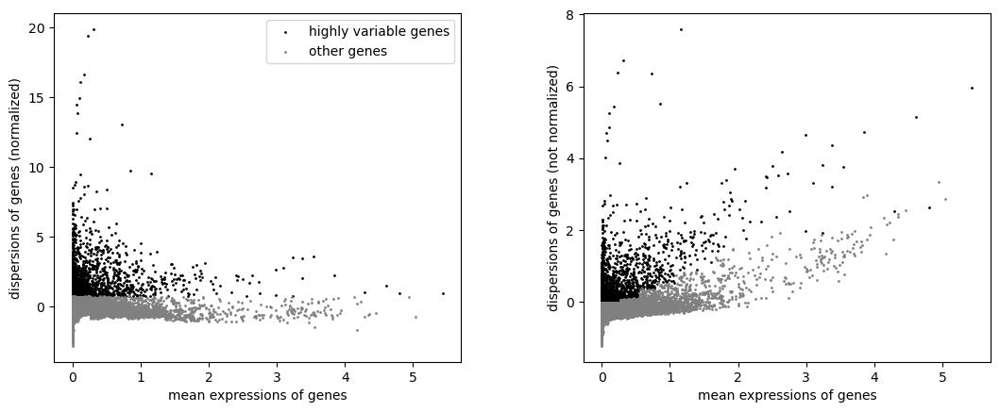

**Figure 4. Highly variable gene selection.** Left: mean expression vs normalized dispersion (gray: all genes; black: the 2,000 selected HVGs). Right: mean expression vs unnormalized dispersion. The HVGs lie in the high-dispersion region, consistent with the expression of cell-type-specific genes, and provide a reliable gene set for PCA.

### 4.6 Cell-cycle correction

Differences in cell-cycle stage add non-biological expression variation and interfere with clustering. Following the cell-cycle correction of the original paper, the same cell-cycle gene sets (G1S, S, G2M, M and MG1 phase genes) were used. The main steps were: 1) from the gene lists for each phase provided in the paper, keep the genes present in the data (to avoid failed matches), build the gene-set dictionary `gene_sets`, and check the number of matched genes per phase; 2) compute S and G2M scores and assign cell-cycle phases (phase) with `sc.tl.score_genes_cell_cycle`, and compute the G1S, M and MG1 scores with `sc.tl.score_genes`, so that `adata.obs` gains five phase scores and one phase column; 3) run the downstream analysis on the corrected expression matrix to remove cell-cycle variation.

To evaluate the correction, PCA plots before and after correction were drawn:

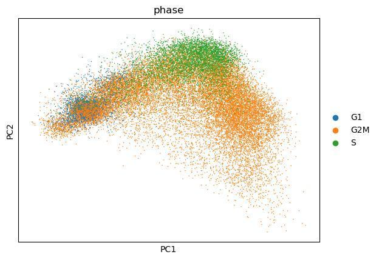 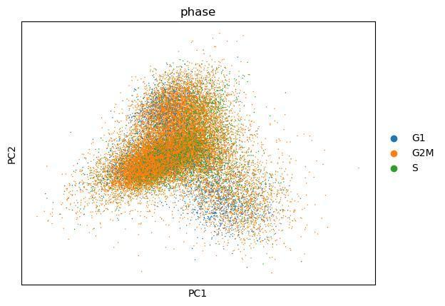

**Figure 5. PCA before and after cell-cycle correction.** Left: before; right: after. PCA shows the cell distribution (x axis PC1, y axis PC2), colored by cell-cycle phase. Before correction, cells in different phases form clearly separated groups in PCA space, indicating a strong effect of cell-cycle variation on the dimensionality reduction.

## 5. Batch Effect Correction

### 5.1 Algorithm choice and principle

The batch-correction R code used in the paper has no Python version. Harmony is highly integrated, which makes it hard to tune its parameters manually to keep the differences between cell types that the different batches represent. This study therefore uses BBKNN (batch balanced k-nearest neighbors). The main reason is that it suits time-course differentiation data: its batch-balanced k-nearest-neighbor logic forces each cell to find neighbors in every batch, preventing cells of the same batch from clustering together too strongly while keeping cell-type differences and differentiation gradients. It is also lightweight and efficient, needs no complex matrix factorization, and suits medium-sized data of thousands to tens of thousands of cells after QC.

BBKNN performs batch correction by optimizing the construction of the neighbor graph. The main steps are: run PCA on all batches together (the first 50 principal components here); set a cross-batch neighbor quota for each cell (5 neighbors per batch, following the per-batch cell classification of the paper); search neighbors within each batch independently and merge them; and finally build a batch-balanced global neighbor graph, so that cell connections are based on expression similarity rather than batch origin, removing technical bias while keeping biological features.

### 5.2 Evaluation

Visual comparison: UMAPs before and after batch correction are shown below.

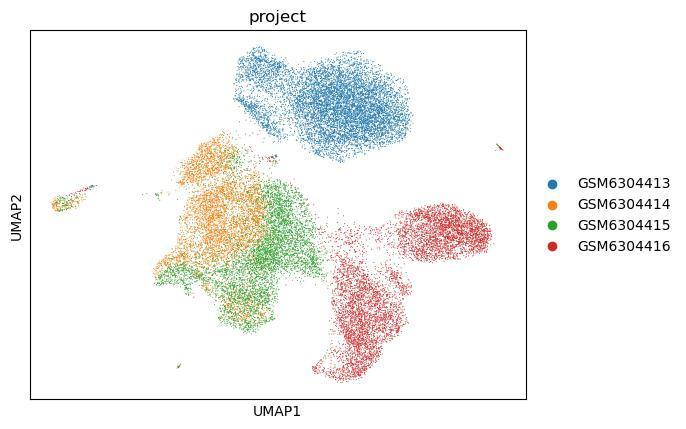 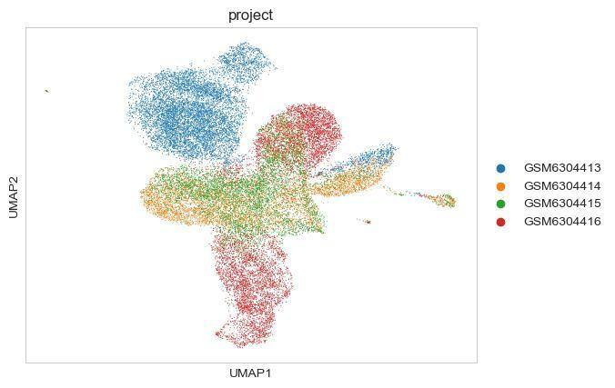

**Figure 6. UMAP before and after batch correction.** Left: before correction, colored by experimental batch. Cells from each batch cluster together with clear boundaries between batches, indicating a strong batch effect. Right: after correction, cells from different batches are mixed and the batch clustering disappears, showing that BBKNN effectively removed the batch effect.

## 6. Cell Clustering and Annotation

### 6.1 Clustering

Clustering: cells were clustered with the Leiden algorithm on the BBKNN-corrected neighbor graph. Leiden optimizes a modularity score and is both efficient and accurate, suiting the medium-sized data of this study. The resolution was set to 0.5 (`resolution=0.5`) because the paper's resolution (1.5e-5) tends to merge clusters, while 0.5 was found in pilot runs to balance cluster granularity and purity. `random_state=42` was set for reproducibility.

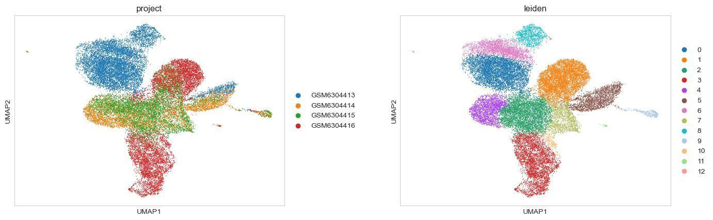

**Figure 7. UMAP of the Leiden clustering.** On the batch-corrected neighbor graph, Leiden (resolution=0.5) divides the cells into 13 clusters, shown on the UMAP and colored by cluster ID (0–12). Each cluster forms a relatively separate group in UMAP space, indicating good clustering.

### 6.2 Cell type annotation

Marker gene selection: following Figures 5D, 5E, 5F, 5G and 5I of the original paper, specific marker genes for 5 cell types were selected for annotation:

`marker_genes = {"EB (Erythroblast)": ["GYPA", "KLF1", "EPB42"], "EB_like": ["ITGA2B", "IFI27", "HBD"], "iPEM": ["CD44", "LMO4", "ANXA1"], "iMK": ["ITGA6","GP1BA","GP9","F2R"], "iMK_2": ["CD53","CD52","KIT"]}`

The EB markers are erythroid feature genes, the iPEM markers come from Figure 5F of the paper, and the iMK and iMK_2 markers were selected from megakaryocyte-specific genes. A dot plot of these markers across clusters was used to assign clusters to cell types.

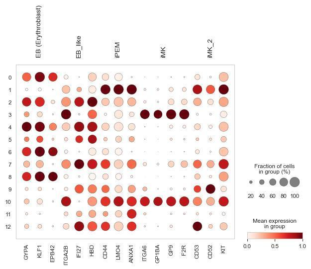

**Figure 8. Dot plot of marker genes per cluster.** y axis: Leiden clusters (0–12); x axis: marker genes of the 5 cell types (EB, EB_like, iPEM, iMK, iMK_2). Dot color is the standardized expression (darker = higher); dot size is the fraction of cells in the cluster expressing the gene. The characteristic markers of each cluster are clearly visible, for example cluster 3 expresses the iMK markers (GP1BA, GP9, F2R), and cluster 10, annotated as iMK_2, expresses the iMK markers together with CD53 and KIT, providing direct evidence for annotation.

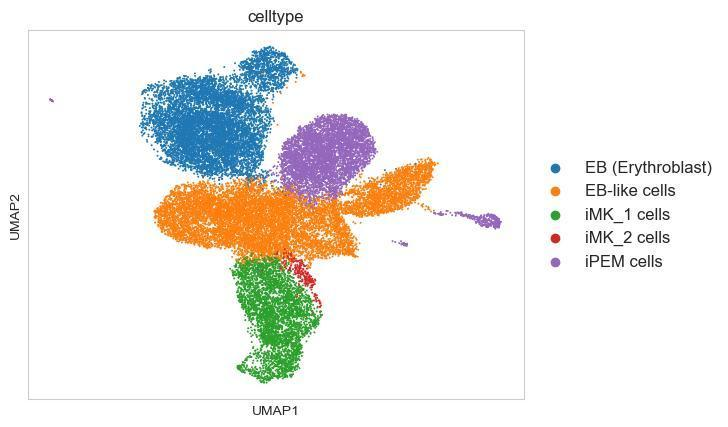

**Figure 9. UMAP of the cell type annotation.** Based on the marker expression in Figure 8, the 13 clusters were annotated as 5 cell types (EB, EB_like, iPEM, iMK, iMK_2), shown on the UMAP and colored by cell type. After annotation each cell type forms a separate group in UMAP space, consistent with the biology of differentiation during reprogramming and with the cell populations in Figure 5B of the original paper.

### 6.3 Marker gene validation

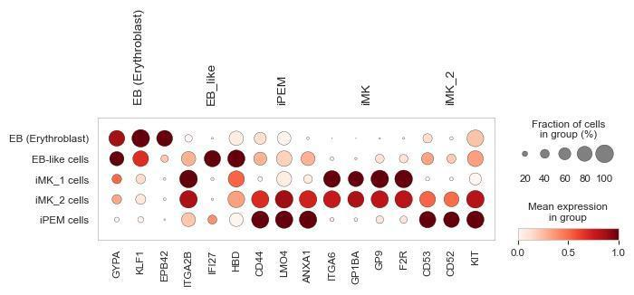

**Figure 10. Heatmap of marker gene expression per cluster.** Rows: marker genes of the 5 cell types (GYPA etc. for EB, GP1BA etc. for iMK); columns: the 5 cell types. The cluster specificity of the marker genes is confirmed.

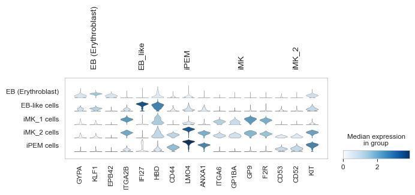

**Figure 11. Violin plots of core marker genes.** Rows: marker genes of the 5 cell types (GYPA etc. for EB, GP1BA etc. for iMK); columns: the 5 cell types. The violin width is the number of cells at each expression level. The reliability of the cell type annotation is confirmed.

### 6.4 Sample proportions

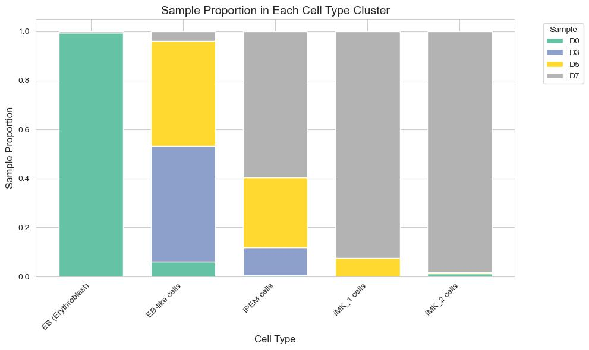

**Figure 12. Stacked bar chart of sample proportions in each cell type.** x axis: the 5 annotated cell types (EB, EB_like, iPEM, iMK, iMK_2); y axis: the share of each sample within the cell type (percentage); colors: samples at different differentiation stages (e.g. immature and mature samples). The chart shows the heterogeneous sample composition of each cell type.

The sample composition of each cell type follows differentiation and is highly consistent with the biology of megakaryocyte reprogramming. The main finding is that iMK (mature megakaryocytes) makes up a much larger share of the mature samples than of the immature ones; together with its enrichment for the platelet activation pathway, this supports more complete megakaryocyte differentiation in the mature samples. In addition, EB (erythroid cells) are most abundant in the immature sample and decline as the samples mature, while iPEM (megakaryocyte–erythroid progenitors) peak in the intermediate samples, consistent with the "EB → iPEM → iMK" differentiation path. These distribution patterns fully match the population dynamics during reprogramming reported in the original paper, further supporting the reliability of the annotation.

## 7. Enrichment Analysis

### 7.1 Design

1. Target clusters: iMK (megakaryocyte precursors) and iMK_2 (mature megakaryocytes) were chosen because they are consecutive key stages of megakaryocyte differentiation, the original paper focuses on their functional differences, and the annotation showed a clear stratification of marker expression between the two clusters, making them worth a functional analysis.
2. Differential genes: the Wilcoxon rank-sum test (the gold standard for single-cell differential analysis) was used, with iMK_2 as the reference (reference="iMK_2 cells") and iMK_1 as the test group (groups=["iMK cells"]), using `sc.tl.rank_genes_groups`. Thresholds were log2 fold change (log2FC) ≥ 0.5 and adjusted p < 0.05, giving the genes up in iMK_1. The differential genes of iMK_2 were obtained the same way (with iMK_1 as the reference).
3. Enrichment: the differential genes of each cluster were tested with Enrichr, requesting the "GO_Biological_Process_2021" and "KEGG_2021_Human" libraries in one call, with adjusted p < 0.05 as the significance threshold, and the top 10 terms labeled as GO were plotted. With gseapy 1.1.11, a multi-library call returns the last library's results under every library label, so the plotted terms are KEGG pathways (KEGG_2021_Human), not GO biological processes.

### 7.2 Results and interpretation

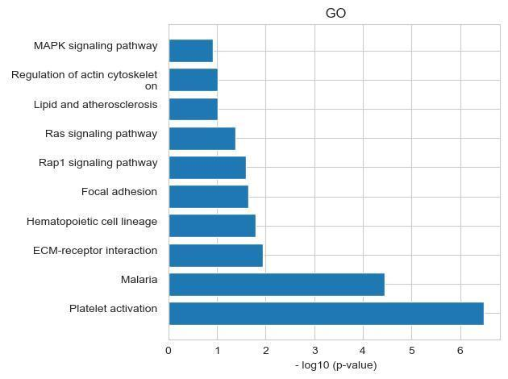 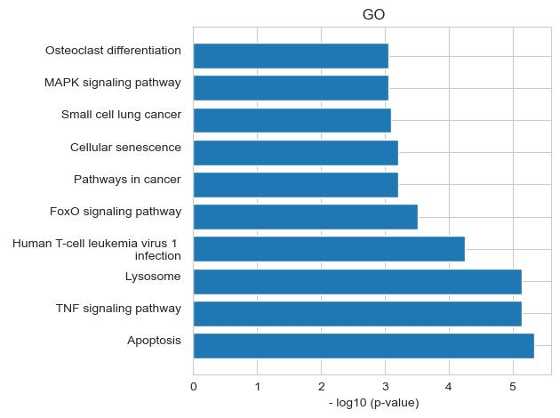

**Figure 13. Pathway enrichment of genes up in iMK.** Left: iMK_1; right: iMK_2. x axis: −log10(adjusted p) (larger = more significant); y axis: the top 10 significantly enriched terms, with term names split over two lines to avoid truncation. The plot titles say "GO", but the terms are KEGG pathways (see Section 7.1).

The top 10 KEGG pathways of the genes up in iMK_1 all relate to the core functions of megakaryocyte maturation and platelet production, with "platelet activation" being the most significant.

The KEGG pathways enriched in iMK_2 point clearly to immune regulation and stress responses. Its top 3 terms are "Apoptosis", "TNF signaling pathway" and "Lysosome". The TNF signaling pathway is central to immune regulation and inflammation, the lysosome takes part in phagocytosis and the processing of immune molecules, and apoptosis relates to the functional homeostasis of mature cells. Together they suggest that after maturation, iMK_2 shifts from "platelet production" to "immune regulation, inflammatory response and cellular homeostasis", which fits its high expression of immune-related markers such as CD53 and CD52.

## 8. Advanced Topic: Effect of Doublet Removal

This analysis is an additional exploration. The methods of the original paper do not mention doublet removal and do not say whether its data contain doublets or how they were handled. To evaluate the possible effect of this step on the core conclusions, this comparison was designed. Because the paper did not use this step, the doublet-removed data were not used in the main analysis, to keep the results comparable.

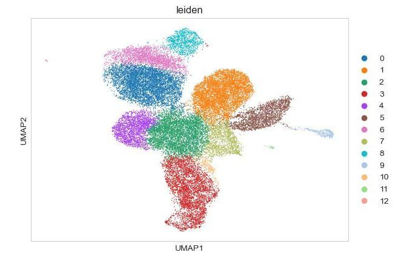 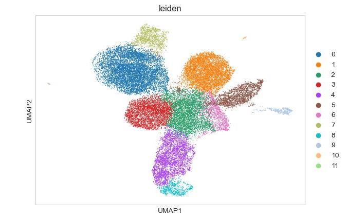

**Figure 14. UMAP of the clustering before and after doublet removal.** Left: Leiden clustering without doublet removal; right: Leiden clustering after doublet removal with Scrublet.

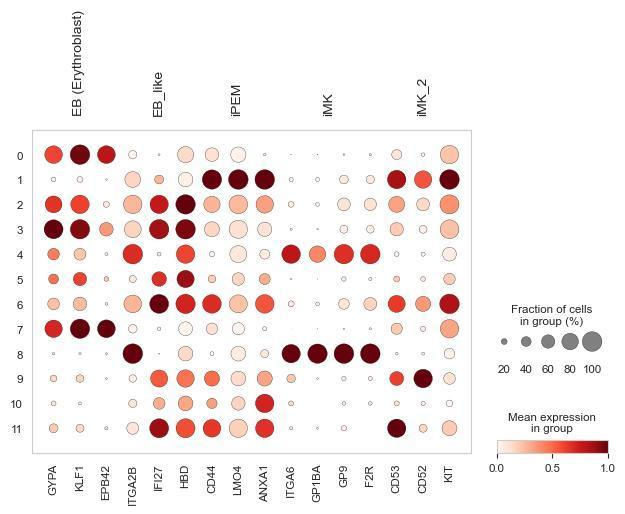

**Figure 15. Core markers after doublet removal.** The color in the heatmap is the marker specificity score.

Figure 14 shows that after doublet removal the number of clusters drops from 13 to 12, and the most notable effect is that the iMK_2 cluster disappears. Based on the data and the algorithm, this is probably the combined result of a high doublet contamination rate and a small cluster size:

1. Cluster size: iMK_2 makes up a small share of all cells and is a low-to-medium-abundance cluster. We suspect its cells are large (megakaryocytes enlarge markedly as they mature) and therefore more likely to form doublets with other cells during single-cell capture, so its doublet contamination is higher than that of other small clusters (by Scrublet, the mean doublet_score of the iMK_2 cluster is 0.32, much higher than the whole-sample mean of 0.064).
2. Algorithm logic: Scrublet identifies contaminating cells by simulating the "mixed expression" of doublets. As mature megakaryocytes, iMK_2 cells highly express immune genes such as CD53 and CD52 and can easily form "megakaryocyte + immune cell" doublets with the rare immune cells in the sample (such as T-cell fragments). Such expression profiles contain both iMK_2 markers and immune genes and are efficiently identified and removed by the algorithm.

## 9. Discussion and Conclusions

### 9.1 Consistency with the original paper

The core conclusions agree closely with the original paper in two respects. First, the main differentiation line is the same: the core "EB → iPEM → iMK" path is reproduced, and the functional specialization of iMK and iMK_2 (platelet production vs immune regulation) fully matches the "dual function" of megakaryocytes reported in the literature. Second, the expression patterns of key markers agree: the cluster-specific expression of core markers such as GP1BA for iMK and GYPA for EB matches Figures 5D–H of the paper.

### 9.2 Differences from the original paper and their causes

There are three main differences from the original paper, each with a clear technical or data-level explanation:

**Reproduction differences caused by the tool platform**: the original paper used R (Monocle 3), while this study uses Python (Scanpy). The underlying implementations of the core algorithms differ: the paper's batch correction (mutual nearest neighbors) and Python's BBKNN build the neighbor graph differently, and Monocle 3's clustering parameters and Scanpy's Leiden optimization target differ slightly, making it hard to reproduce the paper's clustering exactly. The gene annotation database versions and the numerical precision of normalization in Python and R also differ and introduce small deviations.

**Random factors**: clustering, UMAP and other single-cell steps depend heavily on the random seed. This study set random_state=42 for internal reproducibility, but the paper does not publish the random seed of its R code, so cluster numbering and the boundaries of some edge clusters differ (for example, one cluster in the paper corresponds to two small clusters here).

**Distinct populations and unusual states**: this study found two phenomena not reported in the paper. First, cluster 9 has an unusual distribution: it is consistently present in all four time points D0–D7 and is clearly separated from other clusters in UMAP space; the reason is not yet known and needs further study. Second, there are low-frequency unusual cell states, for example iMK_2 cells detected in the D0 sample (about 1.2%). Given their very low frequency and that D0 is the initial stage, two causes are suspected: the clustering resolution is not fine enough (0.5), or a very small number of cells in the D0 sample differentiated spontaneously early, a normal biological fluctuation. In addition, the unusual distribution of some low-frequency cell states in the proportion analysis is directly related to the clustering resolution and to differences in how the tools merge clusters; these low-frequency differences do not affect the reliability of the conclusions about the core differentiation path.

### 9.3 Limitations

**Insufficient parameter optimization**: the Leiden resolution (0.5) is a moderate value chosen in pilot runs and was not systematically optimized over a resolution gradient (0.2–1.0); the BBKNN cross-batch neighbor quota (5 per batch) was not adjusted to the number of batches, which may affect the correction of multi-batch data.

**Incomplete analysis of the distinct population**: for the unusual cluster 9, only its time distribution was described; no targeted differential gene or enrichment analysis was done, so its identity and biological meaning are unclear.

**Single enrichment dimension**: only one database was effectively used (KEGG, see Section 7.1); GO biological processes, Reactome and other databases were not used to analyze the functional differences between iMK and iMK_2 more fully.

### 9.4 Outlook

Systematically optimize the parameters: test a Leiden resolution gradient (0.2, 0.4, 0.6, 0.8, 1.0) and choose the best clustering with the silhouette score; test a gradient of BBKNN neighbor quotas (3–8 per batch) and choose with quantitative batch-mixing metrics.

Study the distinct phenomena in more depth: run a dedicated differential gene analysis for cluster 9 (against all other clusters) and infer its identity from the literature; for the low-frequency iMK_2 cells in the D0 sample, use trajectory inference to determine whether they are early-differentiating "precocious cells" or clustering artifacts.

Broaden the functional analysis: integrate GO biological processes and cell-surface protein databases to find the key pathways and markers of the immune-regulatory function of iMK_2, providing fuller evidence for the dual-function mechanism of megakaryocytes.

## 10. Appendix

Code: the analysis code is in [notebooks/code.ipynb](../notebooks/code.ipynb).

Supplementary figures: see the figures produced by the code.
